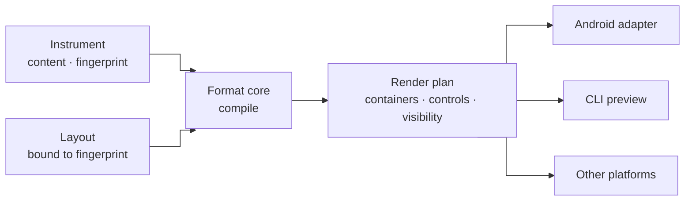

# ADR 0033: Presentation is a separate, published layout, compiled into a render plan

**Status:** Accepted (2026-10-27, architecture review #67) · **Priority:** Must · **Date:** 2026-10-27

**In one line:** How an instrument is grouped on screen is a separate signed artefact (`kind: Layout`). It partitions the instrument's ordered questions into steps, tabs, cards and rows, and never permutes or changes what is asked. The format core compiles it into the same render plan on every platform, and every record names the layout it was collected with.

*The key words MUST, MUST NOT, SHOULD, SHOULD NOT and MAY are to be interpreted as described in RFC 2119 and RFC 8174 when, and only when, they appear in all capitals.*

## Context

The presentation of a survey matters as much as its content. The paper questionnaire shows each food as a row of a 9-column grid. The v0.2 app and its wireframes instead group the same content differently:
- **Step 1:** demographics in four cards on one screen.
- **Step 2:** foods behind category tabs, one card per food, with frequency, amount and "yesterday" together.
- **Step 3:** review.

This is the same data contract in a different arrangement. In the draft spec, presentation was implied by `sections` ("shown as one step"), so changing the grouping meant a new instrument, a new fingerprint and a broken comparison between datasets.

The research points the same way:
- **Hick's law (Hick 1952; Hyman 1953).** Decision time grows with the number of choices. Designs should reduce the options in each decision, break complex tasks into steps, and introduce elements progressively ([lawsofux.com/hicks-law](https://lawsofux.com/hicks-law/)). Its other advice, highlighting a recommended option, is a leading cue in a survey and biases answers, so this ADR rejects it.
- **Grids versus item-by-item.** Survey methodology finds that layout changes the answers. Grid layouts show more straightlining and lower concurrent validity than item-by-item layouts, especially on mobile devices and for scales with 9 or more points (Tourangeau, Couper and Conrad 2004; Mavletova, Couper and Lebedev 2018). Item nonresponse is the more consistent penalty of grids. Because of this, a layout is a variable that analysts need to know about.
- **Question order is content.** Order changes answers through priming, assimilation and contrast, and does so differently by mode. Dillman's unimode design keeps the question form constant across modes. DDI Lifecycle keeps order in the instrument's `Sequence`, not with the questions or their presentation.

## Options considered

| Option | Precedent | Verdict |
|---|---|---|
| A. Grouping inside the instrument | FHIR SDC item controls (`page`, `tab-container`, `grid`); XLSForm `field-list`/`table-list` | Rejected: any regrouping changes the fingerprint, and one layout must fit every screen |
| B. An unsigned metadata or config file | Themes in SurveyJS; CSS | Rejected: layout changes answers, so it must be reviewed, signed and recorded |
| **C. A separate signed layout that partitions, never permutes** | Blaise (data model separate from mode and device layout); DDI (content separate from applied sequence) | **Chosen**: order stays content; arrangement varies by device |

## Decision

- **Content and presentation are separate artefacts.** The instrument ([ADR 0032](./0032-standard-survey-elements.md)) defines what is asked. This includes **question order**. A `Layout` defines only where that ordered sequence is cut into screens and containers, and how each container and control is presented. A layout MUST be published like any artefact ([ADR 0009](./0009-publishing-with-provenance.md)), and it MUST be bound to exactly one instrument fingerprint.
- **A layout arranges; it never rewrites.** It MAY:
  - cut the instrument's question sequence into `step`, `card`, `row`, `table` and `list` containers, with localised container headings;
  - put **sibling groups** of the instrument behind `tabs`, which the collector can visit in any order;
  - choose among presentations that the control allows (for example `segments` or `slider`);
  - set navigation (`linear` or `free`) and the screen size it targets.

  It MUST NOT:
  - change labels, options, option order, rules, units or anything else that is content;
  - add a default or a highlighted option;
  - omit a question;
  - reorder questions: read in layout order, the placed questions MUST be in the instrument's tree order.

  It MUST place every question exactly once.
- **Compiled once, rendered everywhere.** The format core compiles instrument and layout into a platform-neutral **render plan**: a tree of containers and catalogue controls with visibility bound to the rules. Every platform adapter draws the same plan, so grouping is identical on every runtime and in `fieldseal instrument preview`.
- **Defaults.** If a bundle carries no layout, the core generates one deterministically from the instrument's group tree: one step per top-level group, item by item.
- **Choice-load lints (Should).** Lint warns, with thresholds set by publishing policy:
  - when a screen holds more than 7 unanswered decisions, or a visible choice has more than 9 options without chunking;
  - when a `table` places a scale of 7 or more points on a `compact` screen;
  - when progressive disclosure is not used for a dependent item.

  These are warnings, not errors: some instruments need a long scale.
- **Records name their layout.** Every `items` record MUST carry the layout's content address next to the instrument fingerprint, so intake can separate layout effects from real differences.
- **Choosing a layout (Could).** A bundle MAY carry several layouts for one instrument (for example `compact` and `expanded`). Runtime policy MAY let the collector switch between them. Collectors cannot build their own layouts.

## Consequences

- The questionnaire can be laid out as the wireframe intends:
  - demographics as four cards on one step;
  - foods behind 13 category tabs, one card per food;
  - a paper-like `table` variant for large screens.

  Its data stays comparable across all of them.
- Changing grouping after collection starts needs a new layout, not a new instrument. Intake still sees which records used which layout.
- Publishing gains the `Layout` kind. Distribution carries layouts in bundles. The record payload gains one field.
- Platform adapters no longer make grouping decisions, so the Android work in #51 shrinks to drawing the plan's node types.

## Specs

[instrument](../../reference/spec/instrument.md) §5.21, [publishing](../../reference/spec/publishing.md) §1, [distribution](../../reference/spec/distribution.md) DIS-016, [wire formats](../../reference/spec/wire-formats.md) WIRE-051, [collection](../../reference/spec/collection.md) COL-108
