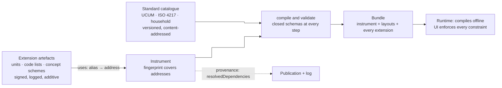

# ADR 0037: No derivations, a standard unit catalogue, signed extensions, and strict schemas everywhere

**Status:** Accepted (2026-10-27, decided by the project lead) · **Priority:** Must · **Date:** 2026-10-27

**In one line:** The tool never computes derived values or converts units (that is the data lakehouse's job); units come from a versioned standard catalogue (UCUM, ISO 4217, household measures with no conversion factors) that authorities extend with signed, published, additive-only `Extension` artefacts carried in every bundle that needs them; and every artefact, manifest and input file has a closed schema that every reader and every UI enforces, with no exceptions.

*The key words MUST, MUST NOT, SHOULD, SHOULD NOT and MAY are to be interpreted as described in RFC 2119 and RFC 8174 when, and only when, they appear in all capitals.*

## Context

Four decisions by the project lead shape this ADR. They are binding, and are quoted here.

1. **No calculations.** "We aren't doing any derivations or calculations here in the tool. That is the data lakehouse's role later on."
2. **Units.** "The units used should have some standard which the users can select from, but also the tool should have an extension framework which allows users to add custom units, which are all signed, included in provenance, and included in whatever bundle is required to compile all the manifests."
3. **Strict schemas.** "Strict schema enforcement is non-negotiable. Any tool MUST conform to it, no exceptions. Therefore, this MUST also apply to the extensions."
4. **UI enforcement** (from testing the HTML preview): a collector could pick 5 options of a "up to 4" multi-choice, and type 100 into a field with a maximum of 20. Declared constraints must be enforced by the UI itself, not only by the core evaluator.

The specs as drafted conflict with the first decision in five places (the *Spec changes* section lists each). The rule language has a `derive` kind and `spec.derived` values (INS-045). Entry units are converted at intake "using UCUM's exact factors" (INS-161), and a bounds check runs "after exact conversion". An open question asks whether portions should be converted to grams at intake. A rule function reads numeric code values (`value()`), which invites scoring. The food-group mapping the first real instrument needs is described as "for indicators" (ADR 0032), which reads as a calculation. None of these is needed to collect data faithfully.

The units text is also open-ended. INS-160 accepts any UCUM code or `{annotation}`, so `{portion_250ml}` and `{each}` are free text with no shared meaning and no way for an authority to say what its custom unit is. Household measures (cup, slice, handful) have no UCUM code that means the same thing to every respondent.

Finally, "closed schema" is stated piecemeal. WIRE-005 and INS-006 reject unknown fields, but nothing says every reader must do so, that authoring files and rosters count, or that a UI must refuse an out-of-range entry. The HTML preview shows the gap.

## Options considered

| Question | Option | Verdict |
|---|---|---|
| Custom units | Free-text UCUM annotations, as now | Rejected: no definition, no review, no provenance, no bundle closure |
| | Fork the standard catalogue per authority | Rejected: the catalogue then has no single identity, so data from two authorities can't be compared |
| | **Signed `Extension` artefacts over a fixed standard catalogue** | **Chosen** |
| Extension scope | Units only | Rejected: the same need arises for code lists and a food-group concept scheme, and a second mechanism later would duplicate this one |
| | Plugins that run code | Rejected: breaks ADR 0010 (declarative, bounded) and zero trust |
| | **Pure data: units, code lists, concept schemes** | **Chosen** |
| Schema enforcement | Core validates, UIs trust the core | Rejected: it is the bug the user hit |
| | **Closed schema for every document; every reader and UI enforces it; shared test corpus** | **Chosen** |

## Decision

### 1. The tool derives nothing

- The tool MUST NOT compute derived values, indicators, scores, aggregates or unit conversions, in any component (CLI, factory, intake, runtime, renderers, data contract generation).
- Records and the landed data hold exactly what was entered, with the unit it was entered in. The data lakehouse converts and derives.
- A mapping from an item or code to a classification (food item to a DQQ food group, a body weight to a LOINC code) is **metadata**: a concept code carried unevaluated into the data contract (INS-170). Looking up that metadata is not a calculation.
- Rules are predicates: they decide `hard`, `soft` and `skip` outcomes. An expression's result is never displayed, recorded or exported. The `derive` rule kind and `spec.derived` are removed.
- Field checks stay as quality flags. Their statistics are internal and are not data.

### 2. A standard catalogue, versioned and content-addressed

A `StandardCatalogue` ships inside the format core, so every tool has the same one. It is a document with a semantic version and a content address (WIRE-011), and every release of a major version keeps all earlier catalogues of that major, so an instrument pinned to an older address still compiles. Its entries are of three kinds:

| Entry kind | Basis | Content |
|---|---|---|
| `measure` | UCUM | The UCUM code, a localised label. Examples: `kg`, `g`, `[lb_av]`, `[oz_av]`, `cm`, `[in_i]`, `mL`, `L`, `min`, `Cel`. |
| `household` | None | A code and localised labels: `cup`, `tablespoon`, `teaspoon`, `piece`, `slice`, `handful`, `bowl`, `glass`. **No size, mass, volume or conversion factor, ever.** The respondent's cup is not a US legal cup. Turning a cup into millilitres is the lakehouse's job. |
| `currency` | ISO 4217 | The alphabetic code, the minor-unit digits, a localised label. Extensions cannot add currencies. |

An instrument pins the catalogue it was validated against by content address. A unit that is not in the catalogue or in a referenced extension is a validation error.

### 3. Extensions: signed, additive, pure data

An **`Extension`** is a new artefact kind published through the normal flow (review, provenance, publisher threshold, transparency log; ADR 0009). One kind carries any of three things:

| Provides | Meaning | Example |
|---|---|---|
| `units` | Custom units of kind `measure` (a valid UCUM code the catalogue lacks), `household` or `count`. No factors. | `sachet`, `serving-spoon` |
| `codeLists` | Reusable code lists in the shape of INS-131 | a locally used frequency scale |
| `conceptSchemes` | A named classification: `{system, concepts: [{code, label, parent?}]}` | a DQQ food-group scheme |

**Referencing.** An instrument declares `spec.uses.extensions: {<alias>: <content address>}` and refers to an entry as `alias:code` (for example `unit: acme:sachet`). The addresses are part of the instrument's canonical bytes, so they are covered by the salted fingerprint (ADR 0027): swapping an extension changes the instrument's identity. An extension cannot reference another extension, so the dependency closure is always one level deep.

**Resolving.** `instrument validate | compile`, the factory and intake resolve each address through an `ExtensionResolver` (a published artefact from the registry, a bundle, or, for authoring only, a local file whose address is computed). They verify its publication, validate it against the extension meta-schema, and check that the instrument uses only entries that exist. The compiled form carries the definitions of the entries actually used, each tagged with its extension's address.

**Bundles.** A bundle MUST carry every extension that any instrument or layout in it references, as a published artefact. The runtime verifies and compiles offline, and rejects the bundle if a reference doesn't resolve. The factory refuses to build an incomplete bundle.

**Provenance.** The instrument's provenance statement lists each extension as a `resolvedDependency` (an SLSA v1 field) with its address, and the data contract names the extensions used. Records need no new field: they already name the instrument's fingerprint, which pins the extension addresses.

**Policy.** Publishing policy decides which extensions are allowed (`publishing.extensions`): an allow-list that only intersects, a limit on kinds, and a ceiling on how many an instrument uses. Layers can only tighten, as in ADR 0011. By default no extension is allowed until a policy lists it.

**Versions and withdrawal.** An extension version is a new artefact with a new address. Instruments pin the old address, so published instruments never change. A minor or patch version MUST NOT remove or alter an entry; codes are stable (as INS-136). A withdrawn extension stops new bundles that depend on it. Runtimes refuse to start new records against an instrument that depends on a withdrawn extension, and still allow review, export and clear.

**Additive only.** An extension MUST NOT redefine or shadow a standard entry, loosen any core schema, or touch a constraint, a control, a rule, a text role or a layout. It has no field in which to do so: the meta-schema simply has no such fields. This is the same tighten-only principle as policy layering.

### 4. Strict schemas, everywhere, for everyone

- **Closed schemas.** Every artefact, manifest and input file (instrument, layout, localisation, policy, trust bundle, deployment manifest, extension, standard catalogue, roster, the authoring forms in YAML and JSON as well as the canonical CBOR) has a closed schema: unknown fields rejected, types and enums exact, no coercion, no duplicate keys.
- **One source.** The schemas are defined once in the format core, and published as JSON Schema (draft 2020-12, closed) addressed by content.
- **Every reader validates.** The CLI, the factory, upload and intake, the device runtimes, the HTML and web renderers, the language bindings and the conformance suite each validate every document they read, before using it. There is no lenient mode, flag or environment variable.
- **Constraints are enforced at entry by the UI itself.** Every constraint an instrument declares on a control (multi-choice `max`, exclusive options, number, stepper, money and date ranges, step grid, `maxLength`, `required`, "other" text) is enforced by every UI at the moment of entry, and also by the core evaluator as a second line. The render plan carries the full constraint set to the adapter, and a UI that cannot enforce a constraint kind is incompatible with an instrument that uses it (INS-025).
- **A test obligation.** Every UI passes one shared scenario suite of attempted violations (select a fifth of four; type 100 where the maximum is 20; select a second exclusive option) and each must be refused, leaving the pending record unchanged.
- **The extension meta-schema** is a closed, versioned schema in the format core. A document declares the meta-schema version it needs. A reader accepts the same major version with an equal or higher minor, and validates the document against the schema of the version it declares, not its own newest one. Released meta-schema versions are never edited.

## Spec changes this ADR implies

New requirements in the specs have these IDs: `INS-226`–`INS-256`, `WIRE-208`–`WIRE-213`, `PUB-122`–`PUB-127`, `DIS-074`–`DIS-077`, `POL-063`–`POL-064`, `INT-083`–`INT-084`, `PLAT-066`–`PLAT-068`, `CLI-040`–`CLI-043` and `DEP-071`–`DEP-072`.

Existing text amended or withdrawn:

| Where | What it said | Change |
|---|---|---|
| Instrument §5.5 table and INS-045 | `derive` rule kind and `spec.derived` compute values | Withdrawn in favour of INS-227; the grammar loses the `derive` row |
| INS-161 | Intake converts entry units to the item's unit with UCUM's exact factors; bounds checked after exact conversion | Values stay as entered with their unit; bounds are declared per entry unit (INS-229) |
| INS-160, INS-162 | Any UCUM code or annotation is a unit | Units resolve to the catalogue or an extension (INS-235) |
| Instrument open questions 2 and 4 | Record derived values by default? Convert portions to grams at intake? | Resolved: no, and no |
| ADR 0032 context row "Food groups mapped … for indicators" | Reads as a calculation | Clarified in this ADR: a food-group mapping is a concept code |
| Instrument §1 and §2 | "derived values", "derivation rule" in the scope and domain model | Reworded |
| Conformance row "Entry units and money convert exactly" | Tests exact conversion | Tests that nothing is converted |

Existing code implements `derive` and entry-unit conversion (`crates/contexts/instrument`, intake). The spec is now amended; removing that code is part of the build of this ADR.

## Consequences

- The tool gets simpler and more auditable: nothing it emits has been computed. Analysts get the entered value, its unit and its concept codes, and own every derivation.
- Authorities can describe their own units and classifications without a release, and with the same review and provenance as an instrument.
- A bundle may grow by the size of its extensions. Extensions are small documents, and the size limit of WIRE §6.7 applies.
- Rules lose `derive`, so an instrument can no longer show a computed value (a BMI) to the collector. That is intended.
- Every reader pays for schema validation, and every UI must implement the constraint set. The shared scenario suite makes the second cost testable once.
- Existing instruments that use arbitrary UCUM codes or annotations must move those units into an extension. Nothing has been released, so this costs only the examples.
- Supersedes nothing. Amends ADR 0032 (units, concept codes) and builds on ADRs 0009, 0010, 0011, 0027, 0028, 0033 and 0034.

## Specs

[instrument](../../reference/spec/instrument.md) §5.22–5.25 and §6.3, [wire formats](../../reference/spec/wire-formats.md) §5.18, [publishing](../../reference/spec/publishing.md) §5.11, [distribution](../../reference/spec/distribution.md) DIS-074–DIS-077, [policy](../../reference/spec/policy.md), [intake](../../reference/spec/intake.md), [platform profiles](../../reference/spec/platform-profiles.md), [CLI](../../reference/spec/cli.md), [deployment](../../reference/spec/deployment.md)
