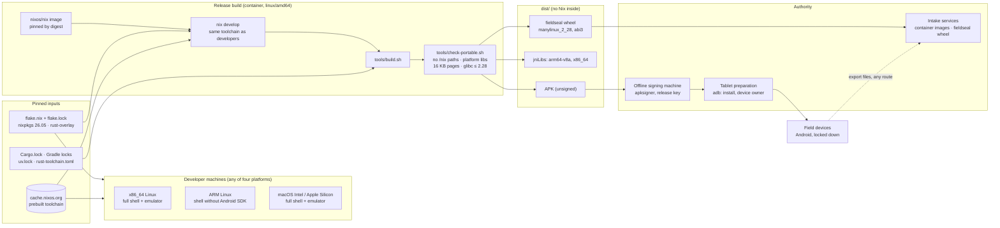
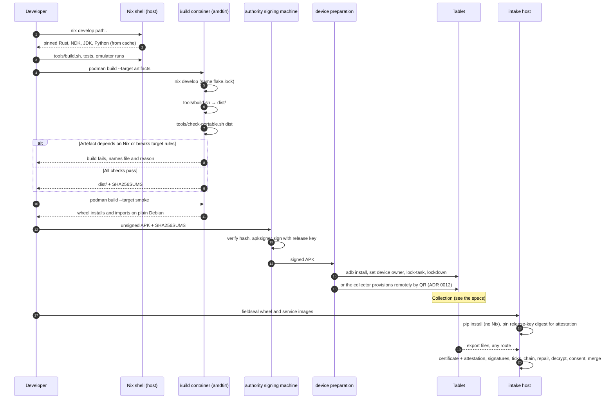

# How the build works, and why

**Status:** Draft v0.1 · **Date:** 2026-09-25
**Companions:** [ADR 0005](./adr/0005-format-core.md) (format core) · [ADR 0025](./adr/0025-twelve-factor-deployments.md) (twelve-factor) · [Toolchain reference](../reference/toolchain.md) · [Build and check](../how-to/build-and-check.md)

Two rules govern the build:

1. **Nix provisions the toolchain.** Every compiler, SDK and tool version comes from `flake.nix` and `flake.lock`, so a developer laptop, the build container and any CI runner all use the same bits.
2. **Nothing that ships depends on Nix.** The APK, the Android native libraries and the Python wheels must run on a stock device and a stock Linux host. `tools/check-portable.sh` enforces this on every build, and the container's `smoke` stage installs the wheel on plain Debian to prove it.

## System architecture

**Reasoning.**
- **One toolchain definition.** Developers and the release build read the same `flake.lock`, so "works on my machine" and "works in the release build" mean the same thing.
- **Release builds run on one architecture.** They always run in the container as `linux/amd64`, whatever the host, because Google's Linux Android tools exist only for x86_64 and a single builder architecture keeps release artefacts identical.
- **Developer shells are for fast iteration.** They run natively on each platform.
- **Nix stops at `dist/`.** The portability check is the boundary: nothing past it may refer to Nix.

## Build-to-field sequence

**Notes.**
- **Step 7** is where the Nix boundary is enforced. A release that fails it never leaves the container.
- **Steps 12–13:** the release signing key stays on an offline machine at the authority. The signing certificate's digest is what the devices' key attestation reports, so the intake host pins the same digest (step 18).
- **Steps 17–18:** the Python tool installs from ordinary wheels. The intake host needs Python and pip, not Nix.

## Keeping the artefacts free of Nix

| Artefact | Why it is portable | Checked by |
|---|---|---|
| Android native libraries (`jniLibs/*/libfieldseal_uniffi.so`) | Linked by the NDK against Android's bionic libc; no host paths | `check-portable.sh`: only platform libraries in `NEEDED`, no `/nix` strings, 16 KB-aligned segments |
| APK | Built by Gradle with Android's own packaging; contains the libraries above | Same checks, run on the libraries inside the APK |
| `fieldseal` wheel | Linked with zig against a `manylinux_2_28` glibc baseline, not Nix's glibc | `check-portable.sh` (glibc symbol versions ≤ 2.28, no `/nix` paths) and `auditwheel`; `smoke` stage installs it on Debian |

Two known Nix pitfalls are handled in `flake.nix`:
- **Gradle's aapt2.** Gradle downloads its own `aapt2` binary, which expects a standard Linux filesystem layout. `GRADLE_OPTS` points Gradle at the patched `aapt2` from the pinned SDK instead.
- **The Python wheel.** Built with Nix's own compiler, it would link against Nix's glibc. Building with `--zig --compatibility manylinux_2_28` avoids that.

## Release signing

The container produces an **unsigned** APK, because the release signing key never enters a build environment. The authority signs with `apksigner` on an offline machine. The signing certificate's digest is what Android key attestation reports as the app's identity ([ADR 0012](./adr/0012-local-first-device-keys.md)), so **every release must be signed with the same key**. The intake gate pins that digest.

## Reproducibility

- `flake.lock` pins nixpkgs and rust-overlay, and the base image is pinned by digest.
- `Cargo.lock`, Gradle dependency locking with dependency verification (`gradle/verification-metadata.xml`), and `uv.lock` pin libraries.
- `dist/SHA256SUMS` records the hash of every artefact. **Verified 2026-09-25:** a local build (x86_64 Linux) and the container build of the same commit produced byte-identical native libraries, Kotlin bindings and wheel. Any future difference (APK timestamps, for example) is tracked as a reproducibility bug.
- `tools/build.sh` sets `--remap-path-prefix` so paths compiled into binaries become `/cargo/...` and `/fieldseal/...`. Without it, each builder's home directory, and so their username, ended up in the shipped libraries. `check-portable.sh` rejects any `/home`, `/Users` or `/root` path in any artefact.
- maturin's automatic SBOM is switched off (`[tool.maturin.sbom]`), because it embeds a random serial number, a timestamp and absolute build paths. **Follow-up:** generate a deterministic SBOM (e.g. `cargo-cyclonedx` with paths and timestamps normalised) and ship it next to the wheel.
- The container build still downloads Gradle and crate dependencies (pinned by lockfiles and checksums). The next step is a fully offline build, with Gradle dependencies pre-fetched into the Nix store (e.g. with `gradle2nix`).

## Measured baselines

Recorded on 2026-10-28 on an AMD Ryzen 9 7950X (16 cores, 32 threads), 62 GB of memory, Linux, Nix dev shell with Rust 1.95.0. Later changes are compared with these numbers.

**Build cost and tests (measured).**

| Measure | Value |
|---|---|
| Distinct normal dependencies (`cargo tree --workspace --edges normal --prefix none \| sort -u \| wc -l`) | 332 |
| Cold `cargo build --workspace --timings` (empty target directory, dev profile) | 57.4 s |
| `cargo tree -i arrow` | fails: "did not match any packages" (the passing result) |
| `cargo tree -i parquet` | fails: "did not match any packages" (the passing result) |
| `tools/test-budget.sh` (nextest and doc tests, building excluded) | 6.1 s against the 20 s budget |
| Tests in `docs/reference/test-inventory.md` | 84 tests, 84 requirements |

**`just up` stage tables (not yet measured).** `just up` prints a stage table and writes it to `deploy/local/.generated/stack-timing.txt`; `just images` alone appends its `build-<name>` and `load-<name>` rows to `stack-timing.tsv`. The three runs below need the container stack and were not taken in Phase 0b. Paste each table here when it is run.

| Run | Table |
|---|---|
| `just purge && just up` | not measured |
| `just up` with nothing changed | not measured |
| `just up` after a one-line Rust change | not measured |

**CI warm-cache durations (not measured).** The `ci` workflow starts only for `v*` tags and manual starts, and the repository's CI minutes were used up when this section was written, so it was not started. Run ids and job durations from two runs on one commit (the second after the first finishes, because `ci.yml` cancels in-progress runs for one ref) go here.

Targets for `just up` and for CI are added here when Open Question 1 is answered.

## Emulating and testing the app

No single environment exercises everything, because the security features that matter most exist only in real hardware. Testing is layered:

| Layer | Where it runs | What it covers | What it cannot cover |
|---|---|---|---|
| Rust core tests, golden vectors, fuzzing | Host / container | Formats, crypto, Reed–Solomon repair, merge rules, fault injection (truncation, bit flips) | Anything Android |
| Robolectric + Compose UI tests + Roborazzi screenshots | JVM, no emulator (container-friendly) | Screen logic: unselected/resurvey states, pause/resume, incomplete acknowledgement; screenshots compared against the wireframe | Real camera, keystore, USB |
| **Android Emulator** (x86_64 image, API 36) | Developer machine or CI runner with KVM | The real app end to end; instrumented tests (`connectedAndroidTest`); device-owner provisioning and lock-task mode; airplane mode | Hardware-backed keys, StrongBox, real key attestation, USB OTG sticks |
| **Physical devices** (the procured model) | Test bench at the authority | StrongBox/TEE key generation and attestation, consent-form photos, USB OTG write and read-back, battery and power-cut behaviour | — |

### The emulator in practice

- **Image.** Use an `x86_64` **Google APIs** system image (not "Google Play"), which allows `adb root` and device-owner provisioning. The app runs natively on it because the core is also built for `x86_64-linux-android`.
- **Acceleration.** The emulator needs KVM (`/dev/kvm`). In a container, pass it through (`--device /dev/kvm`) and run headless (`-no-window -gpu swiftshader_indirect`).
- **Camera.** The emulator's *virtual scene* camera can display a chosen image on a wall of a virtual room, so a class-sheet QR image can be scanned end to end. Automated tests instead feed images straight to the decoder.
- **USB export.** The emulator does not emulate a USB mass-storage stick. Tests target the Storage Access Framework, with the emulator's shared storage or a test `DocumentsProvider` standing in for the stick. Real sticks are tested on hardware.
- **Keystore.** The emulator's keystore is software-backed, and its attestation chain does not lead to Google's production roots. Emulator builds are recognisable at the authority, and the intake gate has an explicit **test mode** that accepts the emulator's test roots. That mode must be off in production.
- **Lockdown.** On a fresh image, `adb shell dpm set-device-owner` makes the app device owner, so lock-task mode and the lockdown policies can be tested exactly as they will be on the devices.
- **Nix.** Emulator and system images are large, so they live in a separate `nix develop path:.#emulator` shell, not in the build shell, and the build container does not download them.
