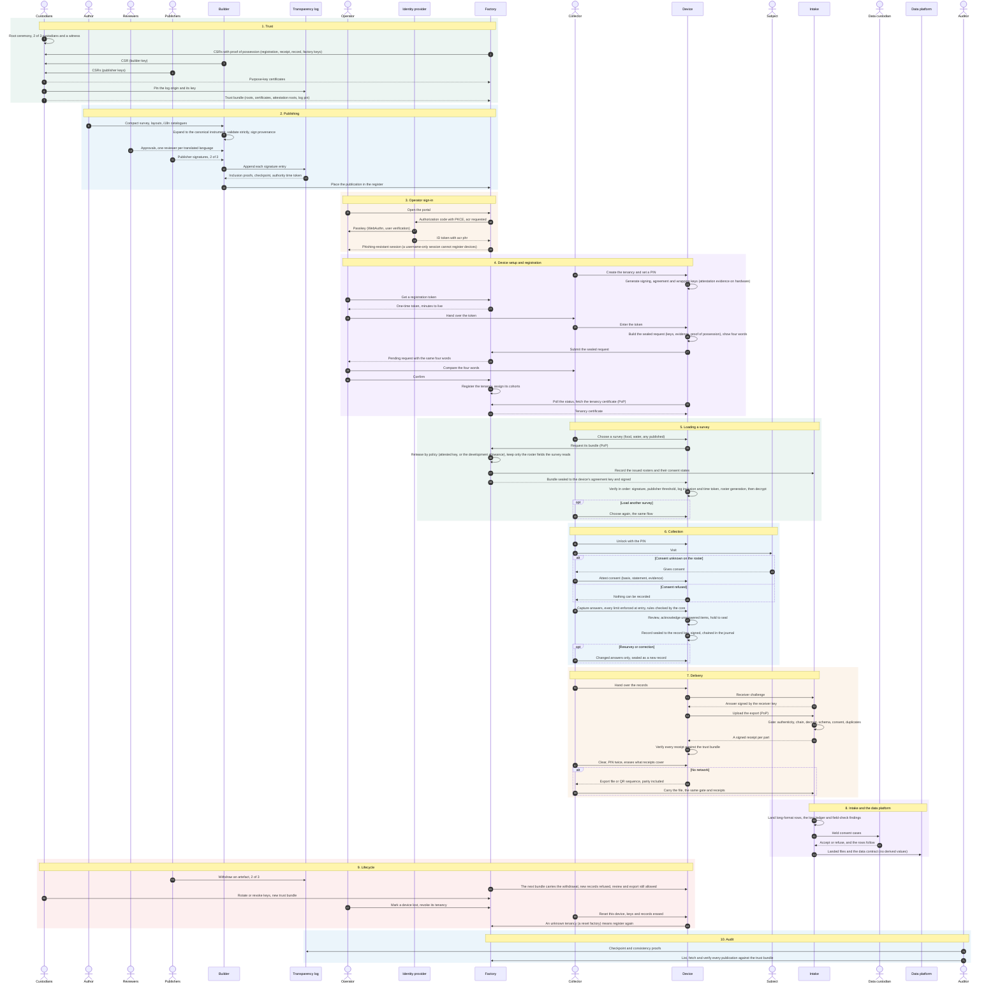

# End-to-end flows

Every persona and every flow, from the root ceremony to the data platform. Development uses software keys and unattested devices; production uses hardware-backed custody and attested devices.

