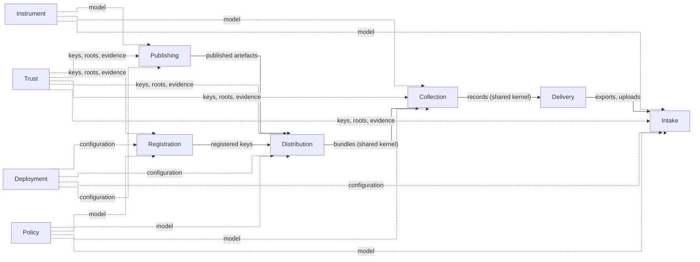
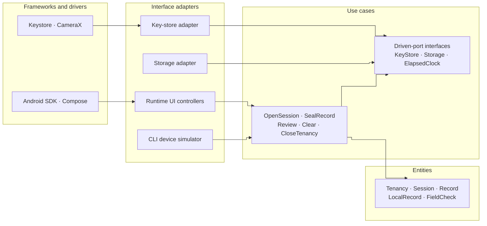

# Fieldseal system overview

Fieldseal collects structured data about people in the field, on devices that may be shared, offline or both, and delivers it to an authority by any route, with provenance from the definition of what is collected to the record that lands. This page shows how the parts fit. Decisions are in the [ADRs](./adr/README.md), normative detail in the [specs](../reference/spec/README.md), and terms in the [glossary](../reference/glossary.md).

## The flow in one paragraph

An **author** writes an **instrument**; **reviewers** approve it; **publishers** sign it; it is logged in a **transparency log** and published with its **provenance**. A **collector** signs in to the authority's **portal**, takes a **registration token** to their **device**, and the **runtime** registers its locally made, hardware-attested keys with the **factory**. The factory builds a **bundle** from published artefacts and the collector's **rosters**, sealed to that device alone. The runtime verifies the bundle and the instrument's own signatures, renders the instrument from its fixed control catalogue, and seals each **record** twice: into the **journal** for the authority, and into the **local record** for the collector to **review**. Records reach **intake** by background upload or an **export** file by any route; intake verifies them, checks each **consent basis**, and lands them in a generic format. Once delivery is confirmed, the collector **clears** the local record.

## Systems architecture

```mermaid
%%{init: {"flowchart": {"curve": "step", "nodeSpacing": 40, "rankSpacing": 60}} }%%
flowchart LR
  subgraph PUBC["Publishing"]
    direction TB
    AUT["Author<br/>writes artefact"]
    REVW["Reviewers<br/>approve (policy: N)"]
    CI["CI build<br/>canonicalise · content address<br/>provenance statement"]
    PSIG["Publishers<br/>threshold signatures"]
    TLOG[("Transparency log<br/>inclusion proofs")]
    AREG[("Artefact registry<br/>instruments · policies<br/>trust bundles · manifests")]
    AUT --> REVW --> CI --> PSIG --> TLOG --> AREG
  end

  subgraph TRUSTC["Trust"]
    direction TB
    ROOT["Offline authority root"]
    HSM["HSM / KMS port<br/>factory · publisher · receipt<br/>record keys per period"]
    ROOT --> HSM
  end

  subgraph FAC["Factory (portal + API)"]
    direction TB
    IDPA["Identity adapter<br/>any IdP · phishing-resistant"]
    TOK["Registration tokens<br/>single use · nonce"]
    ATTV["Attestation verifier port<br/>per platform profile"]
    DREG[("Device and tenancy registry<br/>key history · revocation")]
    PDP["Policy engine port"]
    ROS[("Roster registry")]
    BLD["Bundle builder<br/>HPKE to device key<br/>factory signature"]
    IDPA --> TOK
    TOK --> ATTV --> DREG
    PDP --> BLD
    DREG --> BLD
    ROS --> BLD
  end

  subgraph DEV["Device (shared)"]
    direction TB
    PLATP["Platform profile adapters<br/>key store · attestor · clock<br/>secure display · device policy"]
    SESS["Session<br/>runtime PIN · locks"]
    VERI["Bundle and artefact verifier<br/>factory sig · publisher sigs<br/>log inclusion · schema version"]
    REND["Renderer<br/>control catalogue · rules"]
    JRNL[("Journal<br/>sealed to authority")]
    LREC[("Local record<br/>review · field checks · clear")]
    PLATP --> SESS --> REND
    PLATP --> VERI --> REND
    REND --> JRNL
    REND --> LREC
  end

  subgraph INTC["Intake"]
    direction TB
    UPLD["Upload endpoint<br/>proof-of-possession tokens<br/>signed receipts"]
    GATE["Verification gate<br/>signature · parity · chain<br/>ticks · consent · replay"]
    UPLD --> GATE
  end

  subgraph DATA["Data platform port"]
    direction TB
    RAW["Raw sealed envelopes"]
    LONG["Generic long format<br/>(instrument, subject, item, value)"]
    MODELS["Deployment models"]
    RAW --> LONG --> MODELS
  end

  AREG -- "published artefacts" --> BLD
  HSM -- "signs" --> BLD
  HSM -- "signs" --> PSIG
  TOK -- "token, QR or text" --> PLATP
  PLATP -- "registration request" --> ATTV
  BLD -- "bundle, in-app" --> VERI
  BLD -. "bundle, any route" .-> VERI
  JRNL -- "background upload" --> UPLD
  JRNL -. "export file, any route" .-> GATE
  UPLD -- "receipt" --> LREC
  DREG -- "registered keys" --> GATE
  AREG -- "instrument for replay" --> GATE
  HSM -- "record-key unwrap" --> GATE
  GATE --> RAW
  AREG -- "data contract" --> LONG
```

Solid lines are the connected path; dotted lines are the route for offline and air-gapped devices.

## Bounded contexts

Instrument, Policy and Trust are models every other context uses. Solid lines are the flow of data; the shared kernel ([wire formats](../reference/spec/wire-formats.md)) is the published language on those lines ([ADR 0004](./adr/0004-bounded-contexts.md)).

## One context, in layers

Every context is built the same way: a hexagon of ports and adapters ([ADR 0003](./adr/0003-ddd-and-hexagonal-architecture.md)), organised by clean architecture's dependency rule ([ADR 0028](./adr/0028-clean-architecture.md)). Collection, as an example; every arrow is a source-code dependency, and all of them point inward:

Adapters depend on the port interfaces that use cases own, never the reverse. A new platform, identity provider or HSM is a new adapter that passes the port's contract tests, and CI's architecture tests prove nothing else changed.

## Where things are documented

| Need | Go to |
|---|---|
| A term | [Glossary](../reference/glossary.md) |
| Why something is so | [ADRs](./adr/README.md) |
| Exactly how something must behave | [Specs](../reference/spec/README.md) |
| What a particular deployment runs | Its generated documentation, built by `fieldseal docs build` and bundled with its release ([ADR 0025](./adr/0025-twelve-factor-deployments.md)) |
| How earlier designs reasoned | [Archive](../archive/README.md) |
