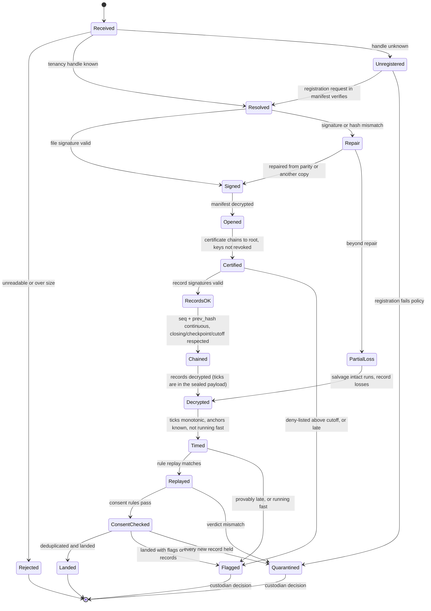

# Intake

**Prefix:** `INT` · **Context:** Intake · **Runs in:** intake · **Status:** Draft

## 1. Scope

Intake verifies everything that reaches the authority from devices, decides consent, and lands records in a generic format that works for any published instrument. It owns:

- the verification gate, from an unknown file to landed records;
- the loss ledger;
- consent decisions: automatic acceptance, sampling, triggers, custodian rules, retrospective exclusion;
- the merge of a subject's records into current state;
- landing into a generic long format, and data contracts generated from instruments.

It does not own byte formats (WIRE), receipts on the device side (Delivery), the instrument model (Instrument), or a deployment's analytical models, which are downstream.

## 2. Domain model

| Element | Kind | Description |
|---|---|---|
| `Submission` | Aggregate | One received export file or upload body: source, `received_at`, gate state, findings. |
| `GateState` | Value object | The state machine position (below). |
| `Finding` | Value object | A flag, repair, loss or rejection, with its rule and evidence. |
| `TenancyView` | Entity | What intake knows about a tenancy: registration, keys, highest received `seq`, closing or cutoff, deny-list status. |
| `VerifiedRecord` | Entity | A record whose signature, chain position and tick have been verified, with its decrypted payload. |
| `ConsentCase` | Aggregate | A subject's consent basis in one tenancy: basis kind, evidence hashes, decision, sampled flag, history. |
| `ConsentDecision` | Value object | `not_needed`, `pending`, `auto_accepted`, `accepted`, `rejected`. |
| `LossLedgerEntry` | Value object | Tenancy, `seq` ranges lost, cohorts and subjects affected, reason. |
| `Observation` | Value object | One landed value: instrument content address, subject, item path, value, source record, tick bounds. |
| `SubjectState` | Read model | The merged current value per item per subject, with its source record. |
| `DataContract` | Value object | Schema and expectations for an instrument's observations, generated from the instrument. |

**Invariants**

- Nothing is decrypted before the file signature and record signatures have been checked.
- A record lands at most once (deduplicated by `record_id` and content hash).
- Nothing is deleted; exclusions and rejections are recorded decisions.

**Domain events:** `SubmissionReceived`, `SubmissionRepaired`, `SubmissionRejected`, `RecordsLanded`, `LossRecorded`, `ConsentDecided`, `ConsentReversed`, `TenancyFlagged`.

### Gate state machine



`Flagged` records are still verified and landed, marked with the flag; `Quarantined` records are held until a custodian decides.

## 3. Driving ports

| Port | Input | Output | Errors |
|---|---|---|---|
| `IngestSubmission` | export bytes or upload body, source | `Submission` with final state and findings; receipt when accepted | `TooLarge`, `Unreadable` |
| `DecideConsent` | consent case, decision, custodian identity | updated `ConsentCase` | `NotPending`, `NotAuthorised` |
| `ReverseConsent` | consent case, reason | exclusion of dependent observations | `NotAuthorised` |
| `ReplaySubmission` | submission ID, instrument and policy versions | findings | `UnknownSubmission` |
| `QuerySubjectState` | subject, instrument | `SubjectState` | — |
| `GenerateDataContract` | instrument content address | `DataContract` | `UnknownInstrument` |

## 4. Driven ports

| Port | Contract |
|---|---|
| `SubmissionStore` | Write-once storage for raw submissions, addressed by content hash. MUST NOT allow overwrite or delete through Intake. |
| `TenancyRegistry` | Reads tenancies, keys, revocations, deny-list cutoffs and successions from Registration. Read-only to Intake. |
| `RecordKeyUnsealer` | Unseals manifests and records with the period's record key, inside the HSM or KMS (TRU). The key MUST NOT leave it. |
| `ArtefactRegistry` | Fetches published instruments and policies by content address, with publishing evidence (PUB). |
| `RosterHistory` | Returns every roster version issued to a tenancy, with consent states and issue times (DIS). |
| `PolicyEngine` | Evaluates intake policy (POL); every result carries the policy content address. |
| `DataPlatform` | Appends raw envelopes, observations, findings, consent decisions and losses; supports retrospective exclusion by flag. A lakehouse is one adapter. |
| `ReceiptSigner` | Signs receipts with the receipt key (TRU). |
| `RandomSource` | Uniform randomness for consent sampling, auditable by seed. |

## 5. Requirements

### Gate order and verification

- **INT-001** Intake MUST process every submission through the gate states in the order shown in §2. It MUST NOT decrypt the manifest before the file signature is valid, nor any record before its signature and chain position are valid.
- **INT-002** Intake MUST store the raw submission write-once before any processing, and keep it for the deployment's retention period.
- **INT-003** Parsing before authentication MUST be limited to the bounded header fields defined in WIRE §export, with a size limit set by intake policy.
- **INT-004** Intake MUST resolve the tenancy handle through the registry. An unknown handle MUST take the `Unregistered` path: the registration request carried in the manifest is verified with Registration's rules (REG), and the submission continues only if it passes.
- **INT-005** If the file signature or a hash fails, intake MUST attempt repair from parity (if present) and then from any other copy of the same records it holds, before declaring a loss.
- **INT-006** The tenancy certificate MUST chain to the authority root, and every signing key used MUST be registered and not revoked at the record's chain position.
- **INT-007** Intake MUST re-check stored attestation evidence against current revocation information, not re-validate the whole chain.
- **INT-008** Record `seq` MUST be continuous and each `prev_hash` MUST match. A record after a closing record, or above a close certificate's or deny-list's cutoff, MUST be flagged.
- **INT-009** A checkpoint record MUST be accepted as the start of a chain segment if its journal hash matches the authority's last received hash for that `seq`, or if no earlier records were ever received (flagged as a gap in the loss ledger).
- **INT-010** Ticks MUST be strictly increasing along the chain, and the slots counted between two anchors MUST NOT exceed the anchors' authority-time difference; a violation MUST flag the tenancy.
- **INT-011** A record whose tick lower bound is after the tenancy window's end MUST be flagged as provably late. A record received after the window end plus grace MUST be flagged as late.
- **INT-012** Intake MUST replay every record's rules with the instrument and rule versions the record names, and quarantine records whose verdicts differ from those the runtime recorded.
- **INT-013** Records MUST be deduplicated on `record_id` and content hash; a duplicate MUST NOT change any landed value.
- **INT-013a** What has landed, and so what is a duplicate, MUST survive a restart of the intake service: the service either keeps its landing durably or keeps every accepted submission (`SubmissionStore`) and rebuilds the landing from them by running them through the gate again, in their original order and at their original times. The development upload endpoint does the latter (`FIELDSEAL_INTAKE_SUBMISSIONS_DIR`), and a repeated upload after a restart changes no landed value.
- **INT-014** Intake MUST return a receipt (DEL-006) for every submission that reaches `Landed`, covering the highest contiguous `seq` held for that tenancy.

### Loss ledger

- **INT-020** When records are beyond repair, intake MUST land every intact run of records and write a loss ledger entry naming tenancy, `seq` ranges, and the cohorts and subjects affected when known.
- **INT-021** A loss ledger entry MUST be resolved only by later receipt of the missing records or by a custodian decision; it MUST NOT be deleted.

### Consent

- **INT-030** Every record about a subject MUST reference a consent basis that precedes it in the chain.
- **INT-031** A roster basis MUST name a roster version issued to this tenancy, with consent `granted` for the subject, and no later version marking the subject `refused` issued before the tenancy imported it (from the import records in the chain).
- **INT-032** An attestation basis MUST be accepted only where the roster version held by the tenancy had the subject as `unknown`.
- **INT-033** Evidence referenced by a consent attestation MUST be present in the submission or an earlier one, and its hash MUST match.
- **INT-034** A record about a subject whose roster consent is `refused` MUST be quarantined.
- **INT-035** Intake policy MUST decide each attestation: `auto_accepted` when every rule passes and evidence is present and auto-acceptance is enabled; otherwise `pending`.
- **INT-036** A random sample of auto-accepted attestations, at the rate set by intake policy, MUST also be sent to review; the sample MUST be drawn from an auditable random source.
- **INT-037** Heuristic triggers defined in intake policy (for example many attestations in a short tick interval, an attestation rate far above a cohort's norm) MUST send cases to review.
- **INT-038** Attestations without evidence MUST follow the custodian's rule in intake policy (`review`, `accept` or `deny`).
- **INT-039** A custodian's rejection MUST exclude every observation that depends on the attestation, retrospectively, by flag. Nothing MUST be deleted.
- **INT-040** Every consent decision MUST record who or what made it, when, and the policy content address.

### Merge and landing

- **INT-050** Intake MUST land every verified record's raw envelope unchanged, then its observations.
- **INT-051** An observation MUST carry: instrument content address, subject ID, item path, value, value type, source `record_id`, tenancy, `(generation, seq)`, tick lower bound, and the record's flags. The subject ID in an observation, in subject state and in consent cases MUST be the lower-case hexadecimal encoding of the subject-ID bytes carried in the record (two digits per byte, no separators); a record whose subject bytes do not form a valid subject ID MUST NOT produce observations.
- **INT-052** Absent items MUST NOT produce observations. Imputed values, if any deployment model creates them, MUST be marked as imputed and MUST NOT be written into the observation table.
- **INT-053** Subject state MUST be computed per subject and item by applying observations in ascending `(generation, seq)`, last write wins, each value keeping its source record.
- **INT-054** Observations from two tenancies with no succession between them for the same subject MUST NOT be ordered against each other; conflicting values MUST be flagged for custodian adjudication.
- **INT-055** Observations excluded by consent or custodian decision MUST be omitted from subject state and from every data-contract view, and kept in the observation table with their exclusion flag.
- **INT-056** Intake MUST generate a data contract for each instrument from its published definition: column types per item path, allowed values, units, required groups, and data-quality expectations derived from its rules.
- **INT-057** Data-quality expectations MUST be evaluated on landing, and their results written as findings, not as rejections, unless intake policy says otherwise.
- **INT-071** The data contract MUST carry item labels and code labels in every language of the instrument, and the landed long format MUST carry each observation's language of administration from the record's `lang` (WIRE-051). Values MUST be landed locale-free ([ADR 0034](../../explanation/adr/0034-internationalisation-and-localisation.md)).
- **INT-058** Intake MUST NOT contain instrument-specific code. Instrument-specific analytical models are downstream of the data platform port.

### Access

- **INT-060** Raw envelopes, consent evidence and the identity link MUST be readable only by the custodian role; observations MUST be pseudonymous.
- **INT-061** Every custodian action MUST be logged as a structured event without personal data in the log line.

### Instrument identity

- **INT-070** Intake MUST key landed data by instrument fingerprint, never by name or version label.
- **INT-072** Every reader of an Intake input (an export header and manifest, a record payload, a registration request and its body, a receipt, and a value read back from the landed state) MUST reject unknown fields, enforce exact types, match enumerations exactly (a status code is `absent`, `declined` or `not-subject`), require every required field, and enforce every declared constraint. A retraction or nonresponse marker is a closed map: `{retracted: true}` and `{nr: <code>}` carry no other field. Nothing is skipped silently.

### Strict inputs and extensions ([ADR 0037](../../explanation/adr/0037-extensions-and-strict-schema-enforcement.md))

- **INT-083** Intake MUST validate every document it receives (an export or upload body, a roster, a manifest, any file an operator supplies) against its closed schema before using any of it (WIRE-208–WIRE-211), and MUST NOT offer a lenient mode. Intake MUST NOT convert units or derive any value (INS-226): each landed observation carries the value as entered, its unit or code, and its nonresponse state.
- **INT-084** Before replaying rules for a record, intake MUST resolve every extension named by the record's instrument by content address, verify its publication as for the instrument (PUB-074), and handle a withdrawn extension as PUB-083 handles a withdrawn instrument.

## 6. Resources and formats

Intake defines no resource kinds of its own; it consumes WIRE §export, WIRE §record and WIRE §receipt, and is configured by intake policy (POL):

```yaml
intake:
  limits: { maxSubmissionSize: 512MiB }
  time: { grace: 30d, provablyLate: flag }
  consent:
    autoAcceptWithEvidence: true
    sampleRate: 0.05
    withoutEvidence: review      # review | accept | deny
    heuristics:
      - name: burst
        params: { count: 20, window: 10m }
      - name: rate-outlier
        params: { cohortRateOverMedian: 3.0 }
  dataQuality: { onFailure: finding }   # finding | quarantine
```

Generic observation layout (logical; the data platform adapter maps it):

| Column | Type |
|---|---|
| `instrument` | content address |
| `subject` | pseudonymous ID |
| `item_path` | string |
| `value` | typed variant |
| `record_id` | UUID |
| `tenancy` | tenancy ID |
| `generation`, `seq` | integers |
| `tick_lower_bound` | authority time |
| `flags` | set of strings |
| `excluded` | boolean, with reason |

## 7. Twelve-factor

| Factor | Intake |
|---|---|
| I. Codebase | One codebase; the same service for every deployment |
| II. Dependencies | Locked; container image |
| III. Config | Registry, HSM, data platform, object store and policy references from the environment; behaviour from signed intake policy |
| IV. Backing services | Submission store, HSM/KMS, registry, artefact registry, data platform, policy engine: attached resources behind ports |
| V. Build, release, run | Immutable image; release = image + deployment manifest |
| VI. Processes | Stateless workers; gate state persisted per submission |
| VII. Port binding | Upload endpoint and custodian API bind HTTPS ports |
| VIII. Concurrency | Scale workers by queue depth; submissions are independent, records per tenancy processed in order |
| IX. Disposability | Each gate step is idempotent and resumable from the stored state |
| X. Dev/prod parity | Same image everywhere; development uses in-memory or local adapters |
| XI. Logs | Structured events to stdout, no personal data |
| XII. Admin processes | `fieldseal intake replay`, `fieldseal intake run` against the same release |

## 8. Conformance

| Test | Covers | Check |
|---|---|---|
| Golden exports: valid, corrupted with parity, corrupted without parity, truncated, replayed, reordered, record after closing, above cutoff | INT-001–014, INT-020 | `fieldseal intake run --json` against golden vectors |
| Unregistered tenancy registered from the manifest | INT-004 | Golden export with embedded request |
| Tick violations: non-monotonic, running fast, provably late | INT-010–011 | Golden journals |
| Consent: refused, unknown with and without evidence, superseded roster, sampling rate within tolerance, triggers | INT-030–040 | `fieldseal intake run` with policy fixtures; sampling checked over a fixed seed |
| Merge across generations and conflicting unrelated tenancies | INT-053–054 | `fieldseal intake replay` |
| Data contract generated from an instrument and expectations evaluated | INT-056–057 | `fieldseal intake run` with the example instrument |
| Closed schemas on every Intake reader | INT-072 | `wire_005_*`, `wire_054_*`, `int_072_*` unit tests |
| Port contract tests for every adapter | §4 | Per-port suites with in-memory adapters |

## 9. Open questions

1. Retention period for raw submissions and consent evidence: set by the custodian per deployment, or a Fieldseal default?
2. Should a deny-listed tenancy's records above the cutoff be quarantined rather than flagged?
3. Is a public transparency log for receipts wanted, so devices can prove what the authority acknowledged?

## 10. References

- ADRs: [0007](../../explanation/adr/0007-zero-trust-posture.md), [0018](../../explanation/adr/0018-dual-write-records.md), [0020](../../explanation/adr/0020-monotonic-ticks.md), [0021](../../explanation/adr/0021-export-upload-receipts.md), [0022](../../explanation/adr/0022-consent-bases.md), [0023](../../explanation/adr/0023-generic-intake-and-landing.md), [0025](../../explanation/adr/0025-twelve-factor-deployments.md)
- NIST SP 800-207, *Zero Trust Architecture*
