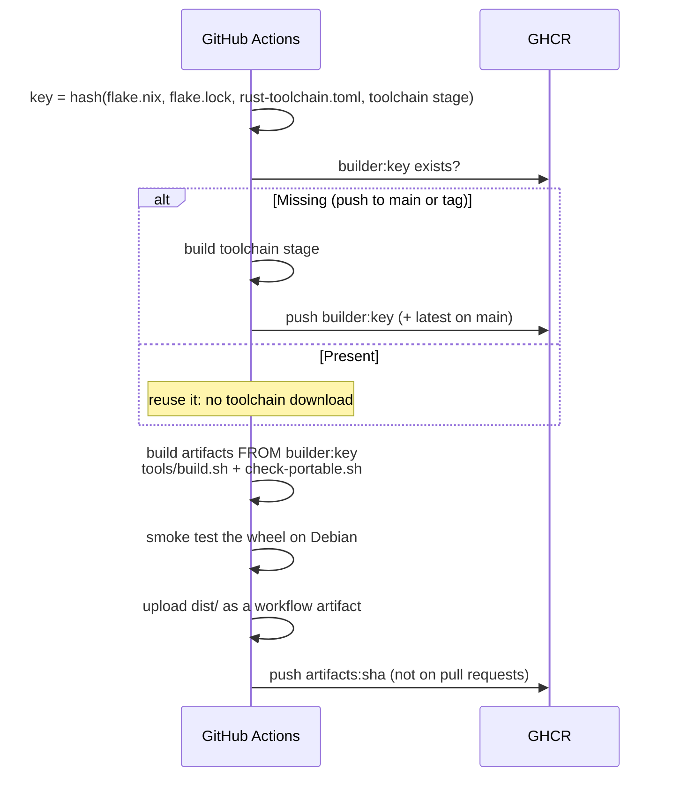

# Toolchain and repository reference

**Companions:** [How the build works](../explanation/build-system.md) · [Build and check](../how-to/build-and-check.md) · [Reuse the CI images](../how-to/reuse-ci-images.md)

## Platform support

| Host | `nix develop` (default) | Android build locally | Emulator (`.#emulator`) | Release build |
|---|---|---|---|---|
| x86_64 Linux | Full | Yes | Yes, x86_64 image (needs KVM) | Container, native |
| ARM Linux (aarch64) | Rust, JDK, Gradle, Python, checks; **no Android SDK/NDK** | No: Google ships no Linux ARM SDK tools. Use the container. | No: no Linux ARM emulator | Container under QEMU (slower) |
| macOS, Apple Silicon | Full (Google's macOS NDK runs natively) | Yes | Yes, arm64-v8a image | Container under Rosetta/QEMU (Podman machine or Docker Desktop) |
| macOS, Intel | Full | Yes | Yes, x86_64 image | Container, native |

- On every host, the Rust core's tests and the Python wheel build run natively. zig lets macOS and ARM Linux produce the same `manylinux_2_28` x86_64 wheel.
- `auditwheel` is Linux-only. On macOS, `check-portable.sh` still enforces the glibc and `/nix` rules and notes that `auditwheel` was skipped.
- The ELF tools (`readelf`, `objdump`, `strings`) come from LLVM so they behave the same on every host. GNU binutils is avoided, because putting GNU `ld` on the PATH breaks linking on macOS.
- **Local and release builds.** Local builds are for development. **Only the container build produces release artefacts**, so a release is the same whichever developer runs it.

## Repository layout

| Path | Contents |
|---|---|
| `flake.nix`, `flake.lock` | The pinned toolchain (`nix develop`) |
| `rust-toolchain.toml` | Rust version, components and cross-compilation targets, read by the flake |
| `Cargo.toml`, `crates/` | Rust workspace, one crate per layer and context ([ADR 0028](../explanation/adr/0028-clean-architecture.md)): `kernel/` (shared kernel), `contexts/<context>/` (domain, use cases, ports, contract tests), `adapters/<technology>/` (port implementations; `memory/` for tests and simulation), `bindings/uniffi` (Kotlin, Swift) and `bindings/python` (PyO3), `apps/cli` (the `fieldseal` CLI and its composition root) |
| `architecture.toml` | The dependency rule: layers, allowed edges between contexts, allowed third-party crates for inner layers, forbidden ambient calls |
| `tools/check-architecture.py` | Fails the build if any crate depends outward or inner code reaches for I/O, time or randomness directly |
| `runtimes/android/` | The Android runtime (issue #51); built by `tools/build.sh` when present |
| `tools/build.sh` | Builds everything into `dist/` |
| `tools/check-portable.sh` | Fails the build if an artefact depends on Nix, leaks a builder path, or would not load on its target |
| `Containerfile` | Stages: `toolchain` (publishable builder image), `build`, `artifacts` (exports `dist/`), `smoke` |
| `.github/workflows/build.yml` | CI: publishes the builder and artefacts images to GHCR and uploads `dist/` |
| `tools/emulator.sh` | Creates and starts the test emulator |
| `docs/` | Documentation, arranged by [Diátaxis](https://diataxis.fr/): `tutorials/`, `how-to/`, `reference/`, `explanation/` (see [`docs/index.md`](../index.md)) |

## Tools

### Provisioning and build orchestration

| Tool | Role |
|---|---|
| **Nix** (flakes) | Pins and provides every tool below. `nixpkgs` follows `nixos-26.05`; Rust comes from `oxalica/rust-overlay` using `rust-toolchain.toml`. |
| **Podman** or **Docker** (with BuildKit) | Runs the reproducible build from `Containerfile` and exports artefacts with `--output`. |
| direnv + nix-direnv *(optional)* | Enters the Nix shell automatically when you `cd` into the repo. |

### Rust format core

| Tool / crate | Role |
|---|---|
| rustc / cargo 1.95.0 | Compiler, with targets `aarch64-linux-android` (devices), `x86_64-linux-android` (emulator) and `x86_64-unknown-linux-gnu` (factory, intake, CLI, tests) |
| **cargo-ndk** | Cross-compiles the core for Android ABIs using the pinned NDK |
| **UniFFI** (`uniffi` crate + `uniffi-bindgen` binary in `fieldseal-uniffi`) | Generates the Kotlin bindings the app calls |
| **PyO3** + **maturin** | Builds the `fieldseal` Python wheel for authority-side tools (abi3, one wheel for Python ≥ 3.11) |
| **zig** | Used by maturin as the linker so the wheel targets `manylinux_2_28` instead of Nix's glibc |
| cargo-nextest, cargo-deny | Faster tests; licence and advisory checks on dependencies |
| cargo-fuzz *(P1)* | Fuzzing the parsers that read untrusted input: class sheets, journals and bundles |
| Crates *(added as the formats are built)* | `chacha20poly1305` (XChaCha20-Poly1305), `aes-gcm`, `x25519-dalek`, `hkdf`, `sha2`, `argon2`, `p256`, `x509-cert` (attestation checks at the factory), `minicbor` or `ciborium` (deterministic CBOR), `reed-solomon` (inner, error-correcting, per record), `reed-solomon-simd` (outer, erasure, per bundle), `uuid`, `zeroize` |

The two Reed–Solomon crates are deliberate. The inner code must *correct* errors at unknown positions, while the outer code only has to *recover* shards already known to be missing (their hashes failed). Erasure-only libraries cannot do the first job.

### Android app

| Tool / library | Role |
|---|---|
| JDK 21, Gradle 9.4.1 (from Nix, no wrapper) | Build. The Android Gradle plugin is pinned to 9.2.1, the newest release that runs on this Gradle (9.3 needs Gradle 9.5, 9.4 needs 9.6). |
| Android SDK platform 36, build-tools 36.1.0 | Compile and package; `apksigner` and `zipalign` come from build-tools |
| **NDK r28c** (28.2.13676358) | Links the Rust core; 16 KB page alignment by default |
| Kotlin 2.4, Jetpack Compose (BOM 2026.06.01), Navigation 2.9 | UI. These are the newest releases that compile against API 36; later ones require compile SDK 37. |
| CameraX + **ML Kit barcode scanning, bundled model** (`com.google.mlkit:barcode-scanning`, not the Play-services variant) | Offline QR reading; ZXing as an alternative |
| Android Keystore APIs (platform) | StrongBox/TEE key generation, key attestation, `k_roster` import |
| JNA (Android AAR) | Required by UniFFI's Kotlin bindings |
| Robolectric, Compose UI test, Roborazzi | JVM unit/UI tests and screenshot tests against the wireframe |
| adb | Provisioning (device owner), sideloading, debugging |

### intake tool

| Tool / library | Role |
|---|---|
| Python 3.12, **uv** (with `uv.lock`) | Runtime and locked dependencies |
| `fieldseal` wheel | Core verification, decryption and merge logic for authority-side tools, shared with the runtime |
| `segno` + a PDF library | Printing seed-share and class sheets |
| pytest | Tests, including golden vectors produced by the Rust core |
| auditwheel | Confirms the wheel is `manylinux_2_28` |
| Databricks CLI / Asset Bundles | Landing to Unity Catalog (see architecture §8) |

## Continuous integration

Two workflows:

- **`.github/workflows/ci.yml`** checks every pull request and `main`. It runs the flake's Rust checks (`nix build path:.#checks.x86_64-linux.{clippy,tests,architecture}`) with Nix directly on the runner. Third-party crates are compiled once into their own derivation (crane `buildDepsOnly`), and every store path is cached: in the GitHub Actions cache (on unless the repository variable `FIELDSEAL_CACHE_GHA` is `off`) and in Cachix when the variable `FIELDSEAL_CACHIX` names a cache and the secret `CACHIX_AUTH_TOKEN` is set. A cached run rebuilds only Fieldseal's own crates. Run the same checks locally with `nix flake check path:.` or the commands above; documentation-only changes skip it.
- **`.github/workflows/build.yml`** builds the Containerfile (Android libraries, Kotlin bindings, wheel, artefacts) only for tagged releases (`v*`) and on demand, and publishes two images to GitHub Container Registry:

| Image | Contents | Tags | Used for |
|---|---|---|---|
| `ghcr.io/rezarajan/fieldseal/builder` | The `toolchain` stage: Nix plus the fully provisioned dev shell | `<key>` (hash of `flake.nix`, `flake.lock`, `rust-toolchain.toml` and the toolchain stage); `latest` from the most recent tagged release | Later CI runs and developers, so nobody re-downloads the Android SDK and Rust toolchain |
| `ghcr.io/rezarajan/fieldseal/artifacts` | `dist/` only (`FROM scratch`): APK, native libraries, Kotlin bindings, wheels, `SHA256SUMS` | commit SHA, branch, and `X.Y.Z` for `vX.Y.Z` tags | Fetching a specific build's artefacts |

- **Pull requests never publish.** If a pull request changes the flake inputs, its builder image doesn't exist yet, so the run builds the toolchain inline and discards it. The image is published when the change lands on `main`.
- **A key is never overwritten.** The builder key is derived from everything the toolchain stage depends on, so a given tag always means the same toolchain.
- **Actions are pinned to commit SHAs,** with the release noted beside each, so a moved tag can't change what runs.
- **Disk space:** the toolchain image is several GB. Both jobs first remove unused preinstalled software from the runner.

To use these images, see [Reuse the CI images](../how-to/reuse-ci-images.md).
